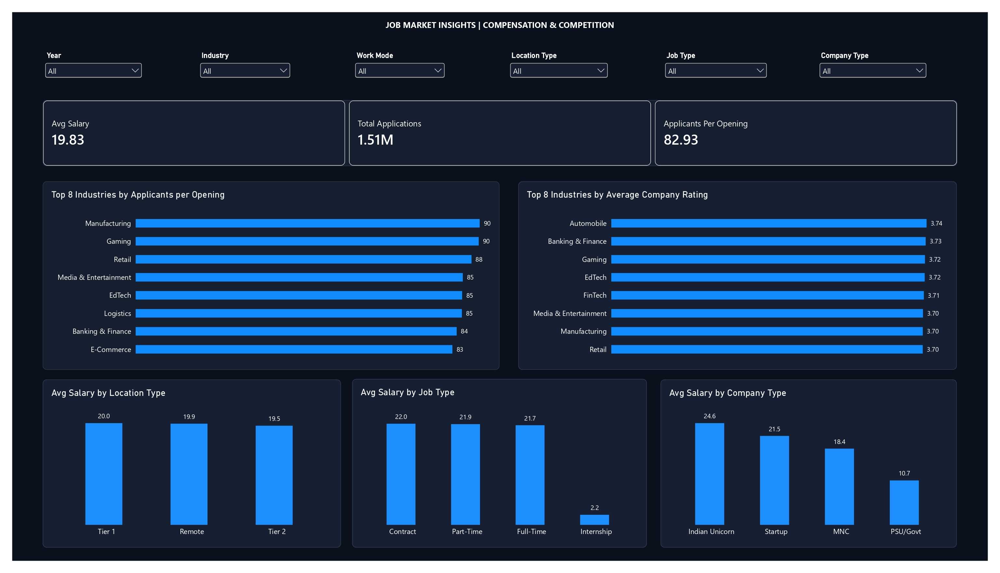
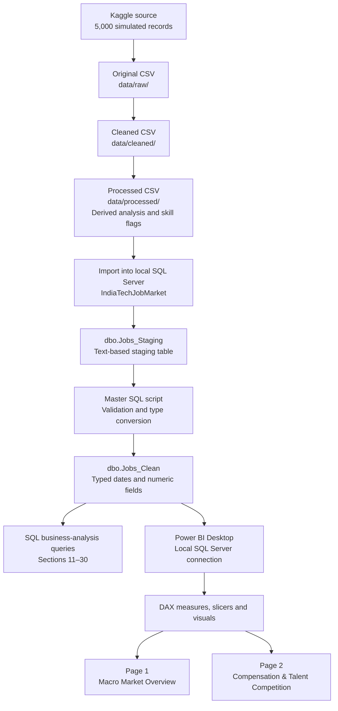

# Job Market & Compensation Intelligence Dashboard (2024–2026)

A two-page Power BI dashboard supported by Microsoft SQL Server (MSSQL) analysis. The project explores hiring volumes, applicants per opening, salary distributions, experience-level demand, workplace modes, and company ratings using a Kaggle dataset of 5,000 simulated technology-job records.
> **Data limitation:** The dataset creator describes these records as simulated. Findings in this project describe patterns in this dataset; they should not be presented as independently verified statistics about India's actual technology job market.

**Tools:** Microsoft SQL Server (MSSQL), SQL, Power BI Desktop, DAX, CSV

**Dataset coverage:** June 2024–April 2026

- **2024:** June–December
- **2025:** January–December
- **2026:** January–April
**Source:** [India Tech Jobs 2024–2026 | Salary & Skills — Kaggle](https://www.kaggle.com/datasets/sridipbasu/india-tech-jobs-2024-2026-salary-and-skills), by Sridip Basu. The source page describes the records as simulated and lists an MIT licence for the dataset.

---
## Dashboard Preview

### Page 1 — Macro Market Overview

Hiring/opening trends across the available dates, openings by industry, demand by experience level, workplace-mode distribution, and salary-band distribution.


### Page 2 — Compensation & Talent Competition

Average salary measures, total applications, aggregate applicants per opening, the Top 8 industries by applicants per opening, the Top 8 industries by average company rating, and salary comparisons by location, job type, and company type.



---
## Project Architecture & Data Flow

The workflow is a local, manually prepared analytics process—not an automatically scheduled data pipeline.

### Repository structure

```text
.
├── data/
│   ├── raw/          # Original Kaggle CSV
│   ├── cleaned/      # Cleaned CSV
│   └── processed/    # Processed CSV with derived fields
├── sql/
│   ├── IndiaTechJobMarket_Project.sql
│   └── README.md
├── Job_Market_Analysis_Dashboard_.pbix
├── Job_Market_Analysis_Dashboard_.pdf
├── page_1_overview.png
├── page_2_compensation_competition.jpg
└── README.md
```

---
## Data Files

The repository keeps the source and prepared CSV files separate so the stages can be reviewed independently.
| File | Purpose |
|---|---|
| [Original Kaggle dataset](data/raw/india_job_market_2024_2026.csv) | Original source CSV (17 columns) |
| [Cleaned dataset](data/cleaned/india_job_market_cleaned_v2.csv) | Prepared dataset with date components, applicant-to-opening ratio, and salary band (22 columns) |
| [Processed dataset](data/processed/india_job_market_final_pre_sql_v1.csv) | Processed dataset with additional skill-category flags (27 columns) |
The original source is retained separately. The prepared CSVs should be interpreted as project outputs, not as independently verified real job listings.

---
## SQL Analysis

The master MSSQL script contains Sections 1–30. It includes staging-data checks, missing-value and data-type validation, date-range checks, creation/reloading of the clean table, and business-analysis queries.

- [Master SQL script — Sections 1–30](sql/IndiaTechJobMarket_Project.sql)
- [SQL documentation and prerequisites](sql/README.md)
The script uses the `IndiaTechJobMarket` database and expects `dbo.Jobs_Staging` to be populated before it is run. It creates `dbo.Jobs_Clean` if needed and Section 10 truncates and reloads `dbo.Jobs_Clean`. Run it only in the intended project database, and back up any data that must be preserved.

The Power BI file uses a local SQL Server connection. Reproducing the report on another computer may require importing the data, configuring the database, and updating the data-source connection.

---
## Key Metrics

The following values were checked against the local SQL Server `dbo.Jobs_Clean` table with read-only queries.

| Metric | Result |
|---|---:|
| Job records | 5,000 |
| Total applications | 1,510,360 |
| Total openings | 18,213 |
| Mean salary | 19.83 LPA |
| Median salary | 13.60 LPA |
| Aggregate applicants per opening | 82.93 |
**Definition:** Aggregate applicants per opening is calculated as `SUM(applicants) / SUM(openings)`. It is not the unweighted average of row-level applicants-per-opening ratios.
### Comparable-period opening changes

Because the dataset has incomplete calendar years, comparisons use overlapping available months:

- **2024:** Returns no year-over-year value because 2023 data is not available.
- **2025:** June–December 2025 compared with June–December 2024; the Power BI measure displayed **−6.1%**.
- **2026:** January–April 2026 compared with January–April 2025. Openings decreased from 3,052 to 2,817, a **−7.7%** change in this dataset.
With all years selected, the KPI uses the latest available year (2026) and therefore displays the January–April comparison. These are changes within the simulated data, not evidence by themselves of a real-world hiring-market contraction.
### Applicants per opening by industry

The ratios below were calculated in SQL Server as total applications divided by total openings for each industry. The dashboard displays the Top 8 and rounds the labels for readability.
| Rank | Industry | Applicants per opening |
|---:|---|---:|
| 1 | Manufacturing | 89.77 |
| 2 | Gaming | 89.52 |
| 3 | Retail | 87.64 |
| 4 | Media & Entertainment | 85.37 |
| 5 | EdTech | 85.20 |
| 6 | Logistics | 85.13 |
| 7 | Banking & Finance | 83.78 |
| 8 | E-Commerce | 82.65 |

Because company-to-industry mappings are unusually broad in this simulated dataset, these rankings are exploratory outputs demonstrating aggregation and ranking techniques. Differences between industries should not be interpreted as reliable evidence of actual industry-level hiring competition.

Information Technology has the highest total opening volume in the dataset, but not the highest applicants-per-opening ratio. These are different measures and answer different questions.
### Salary comparisons by category

| Category | Mean salary (LPA) |
|---|---:|
| **Company type** | |
| Indian Unicorn | 24.62 |
| Startup | 21.52 |
| MNC | 18.45 |
| PSU/Govt | 10.75 |
| **Location tier** | |
| Tier 1 | 19.96 |
| Remote | 19.86 |
| Tier 2 | 19.46 |
| **Job type** | |
| Contract | 22.00 |
| Part-Time | 21.91 |
| Full-Time | 21.68 |
| Internship | 2.19 |
Indian Unicorns' mean salary is approximately **33.4% higher** than the MNC mean in this simulated dataset. This is a descriptive difference, not proof of a causal effect or a verified real-world salary premium.

---
## Data-Quality Checks and Limitations

Read-only checks performed against `dbo.Jobs_Clean` found:

- 5,000 rows in each of `dbo.Jobs`, `dbo.Jobs_Staging`, and `dbo.Jobs_Clean`.
- No duplicate `job_id` values in `dbo.Jobs_Clean`.
- No missing values in the checked critical fields: job ID, industry, salary, openings, applicants, posting date, and work mode.
- No year/month mismatches against `date_posted` and no negative salary, openings, or applicants values.
The checks do not prove that every field is correct or that the dataset represents actual market conditions. Additional limitations were identified:
- **Location/work-mode conflicts:** The dashboard's Workplace Model uses `work_mode`, while Location Type uses `location_tier`; these are separate source attributes. A check found 1,992 records with `city = Remote`: 1,267 also have `work_mode = Remote`, while 376 have `On-Site` and 349 have `Hybrid`. The 725 conflicting records were retained without guessing which label was correct. Remote-related comparisons should therefore be interpreted cautiously.
- **Company/industry mappings:** A SQL check found each of the 53 company labels associated with 11–15 distinct industries. This unusually broad mapping limits how literally company- and industry-level results should be interpreted.
- **Simulated source:** The records are simulated, not a verified census of real job advertisements. The trends and comparisons are for analytical-method demonstrations.
- **Incomplete time coverage:** 2024 contains June–December only; 2026 contains January–April only. Use equivalent periods for comparisons.
- **Descriptive analysis:** Group averages and ratios do not establish causation or statistical significance.
- **Local dependency:** The PBIX uses a local SQL Server connection; refreshes on another computer require setup and connection changes.
The year-slicer measure was tested in the local Power BI report for the available year selections. The complete SQL-to-Power BI refresh workflow has not been independently tested on a fresh computer.

---
## Files

- [Power BI report (PBIX)](Job_Market_Analysis_Dashboard_.pbix)
- [Two-page dashboard PDF](Job_Market_Analysis_Dashboard_.pdf)
- [Page 1 screenshot](page_1_overview.png)
- [Page 2 screenshot](page_2_compensation_competition.jpg)
- [Master SQL script](sql/IndiaTechJobMarket_Project.sql)
- [SQL instructions](sql/README.md)
## License and Attribution

Dataset source: [Sridip Basu — India Tech Jobs 2024–2026 | Salary & Skills on Kaggle](https://www.kaggle.com/datasets/sridipbasu/india-tech-jobs-2024-2026-salary-and-skills). The source page lists an MIT licence for the dataset; retain attribution and consult the source page for its applicable terms. This does not automatically define the licence for the Power BI report or the rest of this project.
