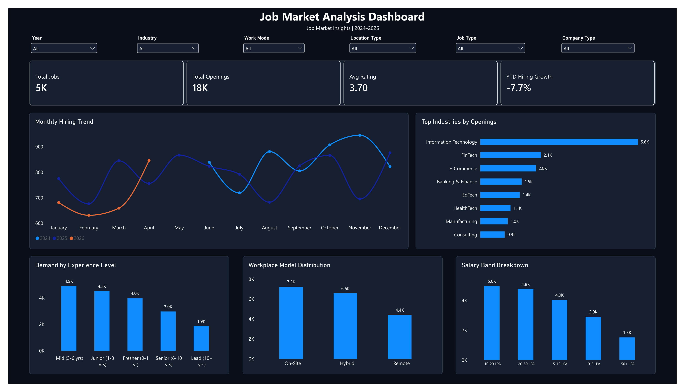
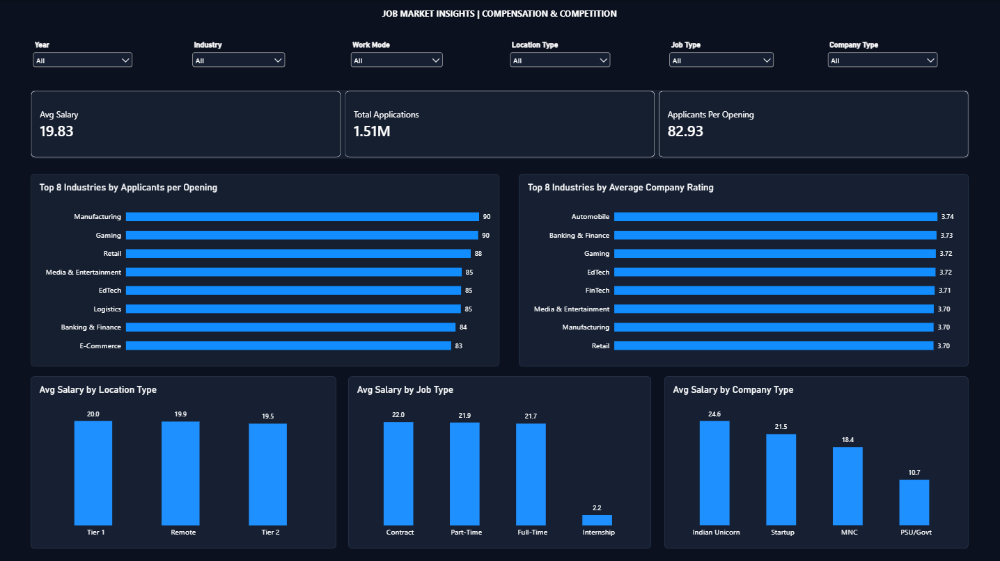

# Job Market & Compensation Intelligence Dashboard (2024–2026)

## Executive Summary

An end-to-end business intelligence project exploring hiring patterns, applicant-to-opening ratios, and salary distributions using 5,000 simulated technology-job records from a Kaggle dataset.

Built using Microsoft SQL Server (MSSQL), Power BI, DAX, and a custom dark dashboard theme (`#0B111E`).

**Important data limitation:** The dataset creator describes the records as simulated. The results in this project describe patterns in this dataset; they are not independently verified statistics about India's actual technology job market.

**Data coverage**
- 2024: June–December
- 2025: January–December
- 2026: January–April

Source: [India Tech Jobs 2024–2026 | Salary & Skills — Kaggle](https://www.kaggle.com/datasets/sridipbasu/india-tech-jobs-2024-2026-salary-and-skills)

---

## Dashboard Architecture

### Page 1: Macro Market Overview

Explores job-opening trends over time, experience-level demand, industries, and workplace-mode distributions.

### Page 2: Compensation & Talent Competition

Explores salary distributions, applicant-to-opening ratios, company categories, and location-based compensation patterns.

---

## Analytical Problems Addressed

### 1. Comparing Incomplete Calendar Years

**Problem:** The dataset does not contain complete calendar years for 2024 and 2026. Comparing a partial year against a full year can create misleading conclusions.

**Approach:** Compare equivalent calendar periods wherever data is available. For example, January–April 2026 is compared with January–April 2025. Comparisons using different numbers of months should not be treated as like-for-like.

For this dataset, total openings fell from 3,052 in January–April 2025 to 2,817 in January–April 2026, a decrease of approximately 7.7%.

This is a result within the simulated dataset, not evidence by itself of a real-world hiring-market contraction. The year-slicer DAX measure requires validation for all supported year selections before its results are treated as final.

### 2. Normalising Applicant and Opening Counts

**Problem:** Total applications and total openings have different scales, making raw counts difficult to use for comparing competition across industries.

**Approach:** Use an aggregate applicants-per-opening ratio:

`Total Applications / Total Openings`

For the current dataset:
- Total applications: 1,510,360
- Total openings: 18,213
- Aggregate applicants per opening: approximately 82.93

This aggregate ratio is calculated as total applications divided by total openings. It is not the average of the individual row-level ratios.

Industry rankings should be validated against all eligible industries before their final values are reported.

### 3. Compensation Comparisons

**Problem:** Salary averages can obscure the effect of a skewed salary distribution, and inconsistent location labels can affect comparisons.

**Approach:** Examine mean and median salary alongside location and company categories. Treat group-level differences as descriptive observations rather than evidence of causation.

Initial dataset statistics:
- Mean salary: 19.83 LPA
- Median salary: 13.60 LPA

The median is useful because it represents the middle observation and is less affected by extreme salaries than the mean.

A data-quality check also identified 725 records where `city = Remote` while `work_mode` is `On-Site` or `Hybrid`. Remote-work comparisons should be treated cautiously until these conflicting labels have been investigated.

---

## Data Files

The repository separates the original data from the cleaned and processed versions.

- [Original Kaggle dataset](data/raw/india_job_market_2024_2026.csv)
- [Cleaned dataset](data/cleaned/india_job_market_cleaned_v2.csv)
- [Processed dataset](data/processed/india_job_market_final_pre_sql_v1.csv)

The original dataset is retained separately so that the preparation workflow can be reviewed. The cleaned and processed files are separate project outputs; their transformations should be documented and validated against the SQL workflow.

---

## SQL Analysis

Microsoft SQL Server (MSSQL) was used for data validation, cleaning, and business-analysis queries.

- [Master SQL script — Sections 1–29](sql/IndiaTechJobMarket_Project.sql)
- [SQL documentation and prerequisites](sql/README.md)

The master script assumes the required database and staging table have been configured. Review the prerequisites and execute the sections in order when reproducing the project.

The SQL files are provided for inspection; the complete workflow should be tested in a separate SQL Server environment before being described as fully reproducible.

---

## Power BI and DAX

The Power BI report includes two dashboard pages, KPI cards, comparative measures, and charts for hiring, competition, and compensation analysis.

The year-over-year hiring comparison is intended to use equivalent available calendar periods. The existing DAX measure must be tested against 2024, 2025, and 2026 slicer selections before it is treated as final.

The PBIX report uses a local SQL Server connection. Refreshing the report on another computer may require updating the connection and configuring the database.

---

## Tools Used

- **Microsoft SQL Server (MSSQL):** Data validation, cleaning, and analysis queries
- **Power BI Desktop:** Dashboard design and visual analysis
- **DAX:** Measures and time-period comparisons
- **CSV:** Source, cleaned, and processed datasets

---

## Limitations

- The dataset contains simulated records and should not be treated as a verified census of actual Indian technology jobs.
- The available dates cover June 2024 through April 2026, not complete calendar years for 2024 and 2026.
- Conflicting location and work-mode labels require further investigation.
- Comparisons are descriptive and do not establish causation or statistical significance.
- The DAX year-slicer logic and full SQL-to-Power BI refresh workflow require validation.

## License and Attribution

Dataset source: [Sridip Basu — India Tech Jobs 2024–2026 | Salary & Skills on Kaggle](https://www.kaggle.com/datasets/sridipbasu/india-tech-jobs-2024-2026-salary-and-skills).

Retain appropriate attribution and comply with the dataset's applicable licence terms. The project code and documentation are separate from the dataset's licensing terms.
